

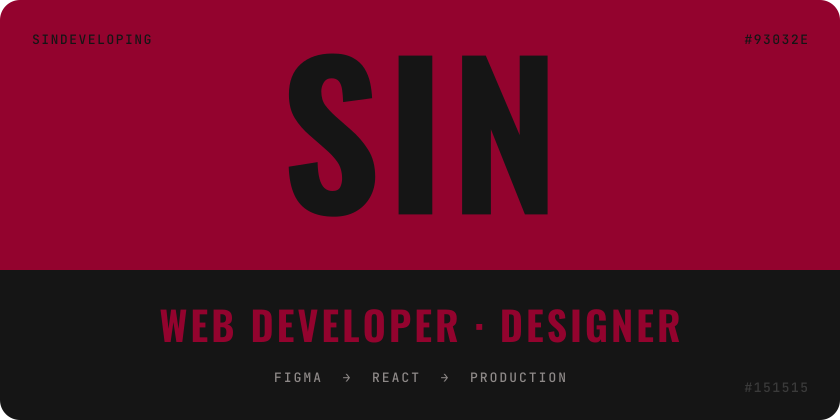

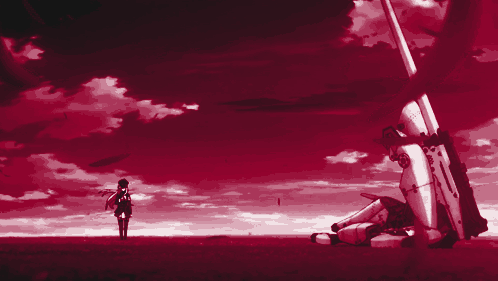

  

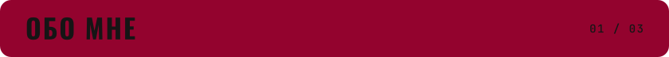

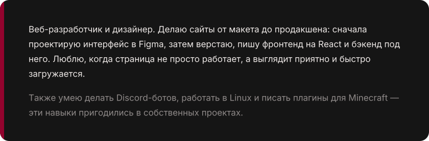

  

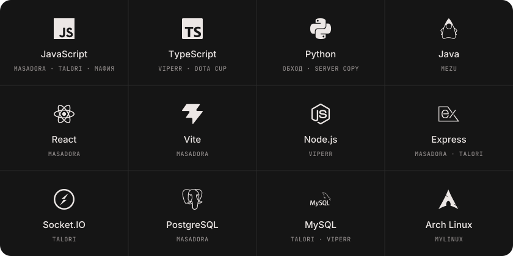

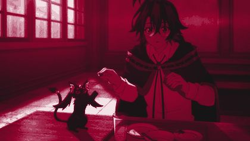
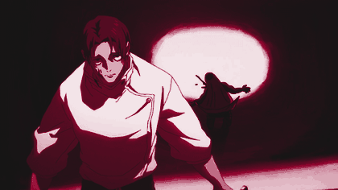

  

<a href="https://github.com/SINDEVELOPING/Obhod">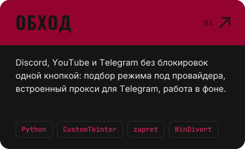</a>

<a href="https://github.com/SINDEVELOPING/mylinux">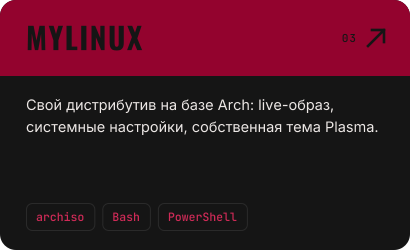</a>
<a href="https://github.com/SINDEVELOPING/mezu">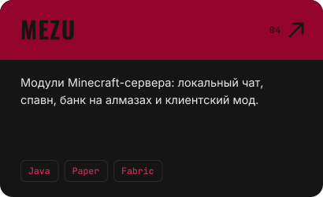</a>
<a href="https://github.com/SINDEVELOPING/mafia-bot">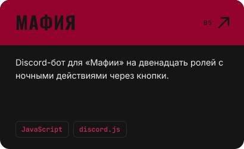</a>
<a href="https://github.com/SINDEVELOPING/server-copy">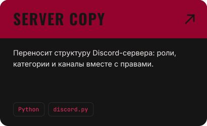</a>

  

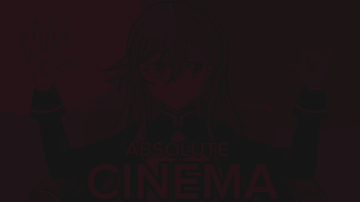

  

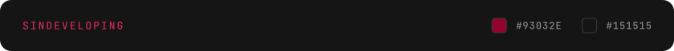

