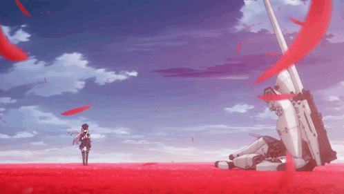
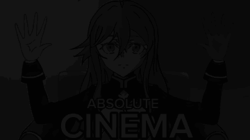

<picture><source media="(prefers-color-scheme: dark)" srcset="assets/design/title-dark.svg"></picture>

<a href="https://github.com/SINDEVELOPING/Obhod/releases/latest"><picture><source media="(prefers-color-scheme: dark)" srcset="assets/design/now-showing-dark.svg"></picture></a>

  

<picture><source media="(prefers-color-scheme: dark)" srcset="assets/design/h-films-dark.svg"></picture>

<a href="https://github.com/SINDEVELOPING/masadora"><picture><source media="(prefers-color-scheme: dark)" srcset="assets/design/credit-masadora-dark.svg"></picture></a>
<a href="https://github.com/SINDEVELOPING/Talori_site"><picture><source media="(prefers-color-scheme: dark)" srcset="assets/design/credit-talori-dark.svg"></picture></a>
<picture><source media="(prefers-color-scheme: dark)" srcset="assets/design/credit-viperr-dark.svg"></picture>
<a href="https://github.com/SINDEVELOPING/mylinux"><picture><source media="(prefers-color-scheme: dark)" srcset="assets/design/credit-mylinux-dark.svg"></picture></a>
<a href="https://github.com/SINDEVELOPING/mezu"><picture><source media="(prefers-color-scheme: dark)" srcset="assets/design/credit-mezu-dark.svg"></picture></a>
<a href="https://github.com/SINDEVELOPING/mafia-bot"><picture><source media="(prefers-color-scheme: dark)" srcset="assets/design/credit-mafia-dark.svg"></picture></a>
<a href="https://github.com/SINDEVELOPING/server-copy"><picture><source media="(prefers-color-scheme: dark)" srcset="assets/design/credit-server-copy-dark.svg"></picture></a>
 

<picture><source media="(prefers-color-scheme: dark)" srcset="assets/design/h-cast-dark.svg"></picture>

<picture><source media="(prefers-color-scheme: dark)" srcset="assets/design/cast-dark.svg"></picture>

  

